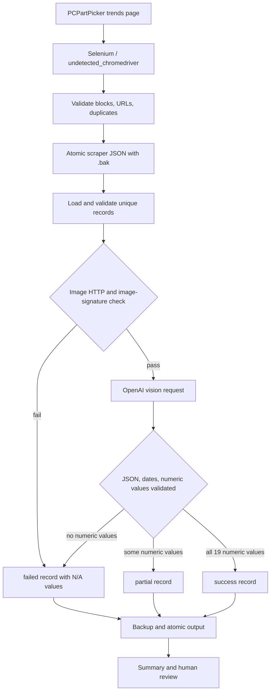

# Implemented Workflow

## Purpose and scope

The pipeline retrieves PCPartPicker GPU trend images and extracts the price at the start of each month from July 2024 through January 2026. This is a chart-reading workflow, so values are observations supported by the image, not a transactional price database.

## Data flow



The scraper uses Selenium only for browser navigation because the page is dynamically rendered. It writes `gpu_model` and `image_url`. The extractor loads those records, removes duplicates, validates image responses, asks the vision model to identify axes and the black line, normalizes the 19 expected month keys, and writes `gpu_model_name`, `image_url`, `price_trend`, `price_quality`, `review_required`, `review_reasons`, and `extraction_status`.

## Status interpretation

- `success`: all 19 months have valid numeric values and no review-triggering quality/reason code.
- `partial`: at least one numeric value exists, but at least one month is `N/A`, with no ambiguity/estimate review flag.
- `needs_review`: numeric values exist, but one or more values are estimated or chart evidence is ambiguous.
- `failed`: no usable numeric values, invalid input/image, malformed response, or exhausted API retries.

## Commands

```powershell
cd <repository-root>
.\.venv\Scripts\Activate.ps1
pip install -r requirements.txt
python -m unittest discover -s tests -v
python gpu_trends_image_extraction.py --limit 1 --output Monthly_Scraped_Data/pcpartpicker_gpu_trends_test.json
python gpu_trends_image_extraction.py --input sample_input.json --limit 3 --diagnostic-dir diagnostics --output Monthly_Scraped_Data/pcpartpicker_gpu_trends_sample.json
python gpu_trends_image_extraction.py --output Monthly_Scraped_Data/pcpartpicker_gpu_trends_latest.json
```

The first extraction command is the controlled test. The three-GPU sample command is the policy-validation gate. The final command processes all valid unique input records and must not be run until the sample results have been reviewed.

The current three-GPU sample did not pass the production gate: direct vision misclassified visible chart history for two GPUs and produced a suspicious sequence for the third. The evidence and manual anchors are in `POLICY_SAMPLE_VALIDATION.md`. A coordinate-calibration stage is recommended before any full batch.

The coordinate prototype is run with:

```powershell
python coordinate_calibration_runner.py --input sample_input.json --calibration sample_calibration.json --output Monthly_Scraped_Data/pcpartpicker_gpu_trends_coordinate_sample.json --artifact-dir diagnostics/coordinate_sample
```

It detects each image's gridlines, verifies the configured visible date anchor against a detected vertical gridline, converts calibrated y positions to USD, writes approved-schema records, and produces one overlay plus one calibration JSON per GPU. The current sample calibration file contains manually verified visible tick labels because OCR is not installed. This is a reviewable prototype, not a production-scale automatic calibration system.

The continuity-aware sampler now examines connected black components around each monthly x position. It uses horizontal support and neighboring samples to select the actual line, rejects isolated vertical spikes with a review reason, and returns `N/A` when candidates remain ambiguous. It never extrapolates or smooths through a missing segment. Diagnostic overlays distinguish accepted samples, rejected spike candidates, and ambiguous candidates. The continuity sample is run separately with:

```powershell
python coordinate_calibration_runner.py --input sample_input.json --calibration sample_calibration.json --output Monthly_Scraped_Data/pcpartpicker_gpu_trends_coordinate_continuity_sample.json --artifact-dir diagnostics/coordinate_continuity_sample
```

## Recovery and troubleshooting

Every existing extractor output is copied to a timestamped `.backup_YYYYMMDD_HHMMSS.json` file before replacement. The scraper keeps a `.bak` copy of its input output. If a run fails, retain the prior output and inspect the log for image validation, JSON parsing, or API retry messages.

Common issues:

- Missing `OPENAI_API_KEY`: set it in `.env` or the process environment.
- Browser startup failure: verify Chrome is installed and rerun with `headless=false` for diagnosis.
- No GPU blocks: inspect the page manually and check PCPartPicker changes.
- All values `N/A`: the API request may have succeeded while the chart was unreadable to the model; treat the record as `failed`, not as a successful empty result.
- API failures: the extractor retries at most twice after the initial attempt, with short exponential delays.

Human review remains required for partial/failed records, suspicious price sequences, estimated values, rejected spikes, and interpretation of visually ambiguous chart points. The external API is not used by the coordinate continuity sample; tests use deterministic images and fakes.
